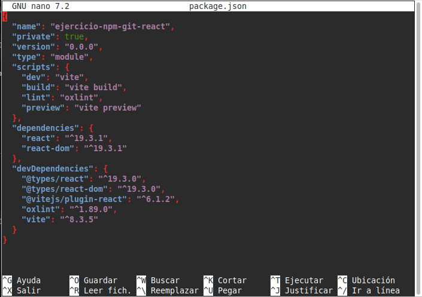
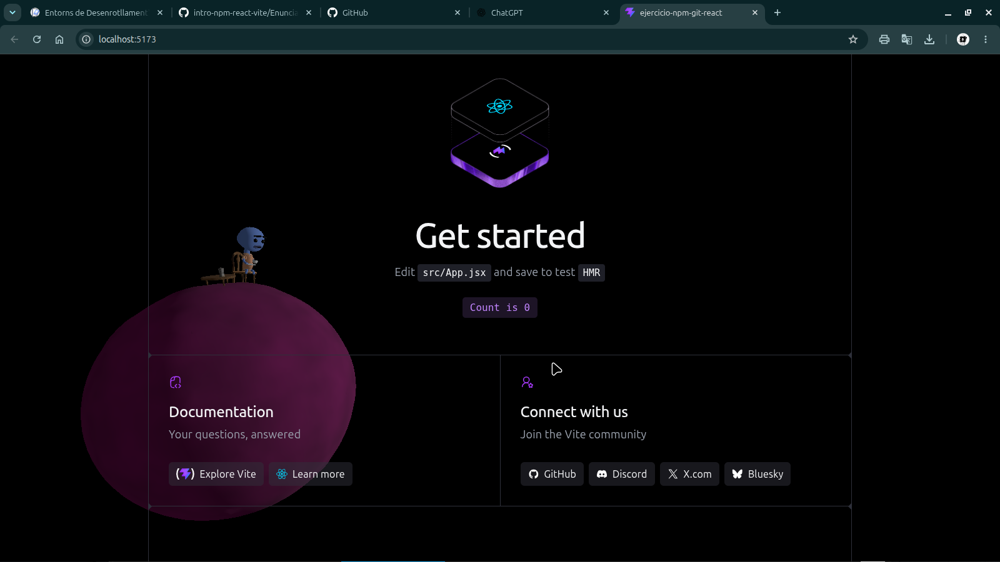

# React-confetti. 

# Canvas-confetti.

# Escena 3D de fondo de pantalla

# Si la carpeta node_modules/ está excluida, ¿borrar una dependencia hace alguna acción sobre el repositorio? ¿Cuál?

- En caso de que la dependencia borrada esté en uso se borrara la linea que la referencia en el package.json, en cambio, si la dependencia no esta siendo usada, no habrá ningún cambio visible en el repositorio.